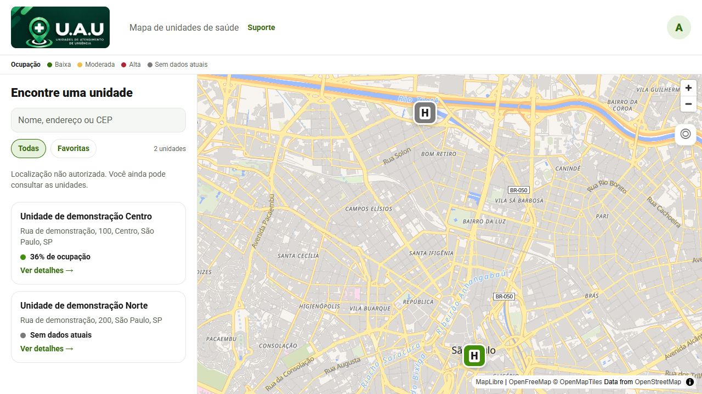
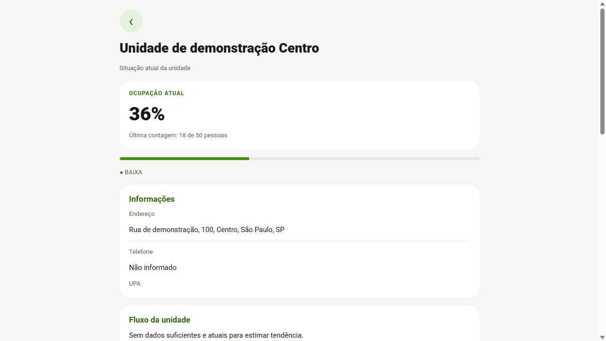

# UAU


## Descrição

O **UAU — Unidades de Atendimento de Urgência** é um sistema web e Android que permite consultar unidades de saúde no mapa e acompanhar a ocupação estimada das áreas monitoradas. Reúne busca por nome, endereço ou CEP, favoritos, avaliações, relatórios em PDF e chat de suporte. O objetivo é facilitar o acesso às informações das unidades. A ocupação observada não equivale ao tempo de espera e não substitui orientação clínica.

## Equipe

Projeto de TCC do grupo 10, desenvolvido por:

| Integrante | Função |
| --- | --- |
| Gabriel Becca dos Santos | Integrante do grupo; função específica a confirmar |
| Matheus de Souza Andreato | Integrante do grupo; função específica a confirmar |
| Kevyn Fernandes Freitas | Integrante do grupo; função específica a confirmar |

## Tecnologias utilizadas

| Camada | Tecnologias e versões declaradas |
| --- | --- |
| Interface web e Android | TypeScript ~6.0.3, React 19.2.3, React Native 0.86.3, React Native Web ^0.21.2, Expo ~57.0.18 |
| Navegação e mapas | React Navigation ^7.3.16, MapLibre GL ^6.9.0, MapLibre React Native ^11.3.8 |
| Servidor | Java 21, Spring Boot 4.1.0, Maven Wrapper |
| Banco de dados | PostgreSQL 15+ (ambiente de validação: 18), migrações Flyway e JPA |
| Relatórios | Apache PDFBox 3.0.8 |
| Visão computacional | Python, OpenCV DNN e YOLOv8n ONNX; versões em [requirements.txt](camera/requirements.txt) |

O HTML e o CSS web são produzidos pelo Expo/React Native Web. Para instalar as versões exatas do frontend, utilize `npm ci`, que respeita o arquivo de lock.

## Organização do repositório

```text
docs/       Documentação técnica, correções e material do TCC
src/        Código Java do backend e recursos do servidor
mobile/     Código compartilhado das interfaces web e Android
camera/     Captura e contagem local de pessoas
design/     Índice dos recursos visuais e capturas da interface
database/   Guia do banco e localização das migrações SQL
README.md   Apresentação e instruções de execução
```

Os SQLs executáveis permanecem em `src/main/resources/db/migration`, onde o Flyway os encontra. Os recursos gráficos usados pelo aplicativo ficam em `mobile/assets`. [Design](design/README.md) e [banco de dados](database/README.md) organizam os links, sem duplicar os arquivos utilizados pelo sistema.

## Imagens do sistema

As capturas abaixo demonstram a página inicial e a consulta de uma unidade, com dados de teste. Não representam medições reais.





## Como executar o projeto

1. Instale os [requisitos](#requisitos) e crie o banco PostgreSQL.
2. Configure as variáveis do servidor conforme [Backend](#backend), incluindo os secrets e as credenciais do banco.
3. Na raiz do repositório, execute `.\mvnw.cmd spring-boot:run` no Windows ou `./mvnw spring-boot:run` no Linux/macOS. A API utiliza a porta 8080 por padrão.
4. Em outro terminal, entre em `mobile`, execute `npm ci` e configure `EXPO_PUBLIC_API_URL` conforme [Android e Web](#android-e-web).
5. Execute `npm run web` e abra o endereço informado pelo Expo. Para Android, siga os requisitos de development build da seção abaixo.
6. Para ativar medições reais, configure o dispositivo seguindo o [guia da câmera](camera/README.md). Sem câmera ativa e medições recentes, a interface mostra “Sem dados atuais”.

## Como citar o projeto

Citação do software, usando o nome atual do sistema:

> SANTOS, Gabriel Becca dos; ANDREATO, Matheus de Souza; FREITAS, Kevyn Fernandes. **UAU — Unidades de Atendimento de Urgência**. Software desenvolvido no projeto de TCC do grupo 10, 2026.

Para citar o trabalho escrito, substitua pelo título oficial, instituição e demais dados bibliográficos da versão entregue à escola. Esses dados e as funções individuais da equipe ainda precisam ser confirmados pelo grupo.

## Correções de acessibilidade e solicitações da banca

Consulte o [registro das correções](docs/CORRECOES_ACESSIBILIDADE_BANCA_2026_11.md), com problema, página, alteração, validação e limitações. A nova avaliação nas extensões WAVE e axe DevTools deve ser registrada separadamente dos testes de código.

## Atualização do nome

O projeto usa **UAU** nas telas, e-mails, relatórios e configurações; identificadores técnicos usam `uau` e variáveis específicas usam `UAU_*`.

Em instalações existentes, atualize as variáveis da câmera e da assinatura Android do prefixo anterior para `UAU_*`, mantendo os mesmos valores. Os links do aplicativo agora usam `uau://`. Sessões anteriores precisam de um novo login e a preferência de tema volta ao padrão.

O banco padrão de desenvolvimento agora se chama `uau`, e o banco isolado de integração, `uau_test`. Para continuar usando um banco existente, mantenha sua URL em `DB_URL`; esta alteração não renomeia bancos nem modifica seus dados. Preserve as chaves `JWT_SECRET` e `RECOVERY_SECRET` configuradas.

A pasta local do checkout e artefatos antigos de build mantêm seus caminhos; o nome da pasta não define a marca do aplicativo. Gere novos builds para distribuir o novo nome.

Aplicativo Android/Web para consulta de unidades de saúde, ocupação de áreas monitoradas, avaliações, favoritos, câmeras e suporte. Backend Spring Boot + PostgreSQL; frontend Expo/React Navigation/MapLibre; contador Python/YOLO. A contagem não representa tempo de espera nem orientação clínica.

## Requisitos

- Java 21 e Maven 3.9 (o wrapper `mvnw`/`mvnw.cmd` baixa o Maven).
- PostgreSQL 15 ou superior; validação realizada com PostgreSQL 18.
- Node.js >=22.13 (validado com 24.19), npm e Expo SDK 57.
- Android Studio, SDK/NDK indicados pelo Gradle e `ANDROID_HOME`; Expo Go não inclui o MapLibre nativo: use development build.
- Python com as dependências de camera/requirements.txt. A câmera usa YOLOv8n ONNX via OpenCV, sem PyTorch no Raspberry; veja camera/README.md.

## Backend

1. Crie um banco vazio `uau` e um usuário próprio com permissão para criar/evoluir suas tabelas. Não use o usuário da escola/produção nos testes.
2. Configure as variáveis abaixo no processo ou gerenciador de secrets. O backend **não carrega automaticamente um arquivo .env**. `.env.example` é uma referência.
3. Execute `./mvnw spring-boot:run` (PowerShell: `.\mvnw.cmd spring-boot:run`).
4. Para empacotar: `./mvnw clean verify`; para executar: `java -jar target/backend-0.0.1-SNAPSHOT.jar`.

| Variável | Uso |
| --- | --- |
| DB_URL | JDBC PostgreSQL; desenvolvimento: jdbc:postgresql://localhost:5432/uau |
| DB_USERNAME / DB_PASSWORD | Usuário e senha do banco; nunca versionar valores reais |
| JWT_SECRET | Secret aleatório de pelo menos 32 bytes, exclusivo do servidor |
| RECOVERY_SECRET | Secret aleatório independente de pelo menos 32 caracteres para HMAC dos códigos |
| JWT_EXPIRATION_MS | Prazo do JWT; padrão 86400000 (24 h) |
| SPRING_PROFILES_ACTIVE | dev ou prod; padrão dev |
| CORS_ORIGINS | Origens exatas separadas por vírgula, incluindo esquema/porta; sem curinga |
| PORT | Porta; padrão 8080 |
| MAIL_HOST / MAIL_PORT | SMTP; padrão smtp.gmail.com:587, substitua pelo serviço real |
| MAIL_USERNAME / MAIL_PASSWORD / MAIL_FROM | Autenticação e remetente reais |
| MAIL_AUTH / MAIL_STARTTLS_REQUIRED | Padrão true; produção deve exigir TLS |
| BOOTSTRAP_ADMIN_EMAIL / BOOTSTRAP_ADMIN_PASSWORD | Bootstrap opcional, descrito abaixo |
| DB_BASELINE | Somente migração inicial de uma instalação legada, após backup |

Os ajustes locais do usuário foram preservados: desenvolvimento aceita o fallback local de recuperação e baseline automático. O perfil prod exige RECOVERY_SECRET explícito e mantém DB_BASELINE=false por padrão. Antes da primeira migração de qualquer banco com dados, faça backup.

Gere os secrets com gerador criptográfico local e armazene-os fora do repositório. JWT usa ID imutável + versão de autenticação. Tokens antigos são recusados; após atualização todos devem entrar novamente. Redefinição de senha e desativação invalidam sessões anteriores. Mudanças de papel são consultadas no banco em cada requisição.

### Administrador inicial

Em banco sem ADMIN ativo, configure temporariamente BOOTSTRAP_ADMIN_EMAIL e BOOTSTRAP_ADMIN_PASSWORD (mínimo 12 caracteres, máximo 72 bytes UTF-8). Reinicie uma vez. O bootstrap usa bloqueio no banco, não promove um e-mail já cadastrado e não imprime credenciais. Remova ambas as variáveis depois. Não existe senha padrão do produto.

A gestão de usuários permite criar, consultar, editar papel/dados e **desativar/reativar**. Não há exclusão física: avaliações, autoria do suporte e histórico são preservados. Autorrebaixamento, autodesativação e remoção do último ADMIN ativo são bloqueados.

### Migrações e atualização de instalação existente

Flyway executa as migrações versionadas disponíveis em `src/main/resources/db/migration` e a migração Java V3; Hibernate apenas valida (`ddl-auto=validate`).

1. Pare escritores (backend/câmeras) e faça backup completo com `pg_dump`; valide sua restauração em outro banco.
2. Atualize primeiro uma **cópia** do banco e confirme esquema, contagens e dispositivos.
3. Se já existe o esquema Hibernate e **não existe histórico Flyway**, configure DB_BASELINE=true apenas nessa primeira execução. O baseline é versão 0; V1 usa CREATE TABLE IF NOT EXISTS. Não use baseline em versões arbitrárias.
4. Inicie o backend com novos secrets/configuração e confira as migrações. Remova DB_BASELINE.
5. V2 adiciona autenticação, metadados, suporte, recuperação e índices. V3 transforma cada chave antiga em SHA-256, remove a coluna em texto puro e preserva os dispositivos. Se houver mais de uma câmera ativa na unidade, mantém a de menor ID ativa e desativa as demais. Confira essa escolha no painel.
6. V4 acrescenta UUID de medição e unicidade para retries idempotentes. Histórico anterior é preservado; vínculos de dispositivo de medições antigas permanecem nulos.
7. Atualize câmera e frontend juntos: o endpoint antigo de medição por unidade foi removido. A chave antiga continua válida após o hash; se não a possui, regenere no painel.
8. Valide login, unidade, favoritos, câmera e suporte. Para reverter a migração de hashes, restaure o backup; não há como recuperar a chave original pelo hash.

Nunca execute testes contra o banco original. As migrações não removem registros de usuários/unidades/histórico. Exclusão de unidade pela administração é uma ação explícita e remove suas avaliações, favoritos, dispositivos e histórico em uma única transação.

A migração V7 corrige instalações antigas que ainda possuem `usuario.unidade_atendimento_id`: ao excluir a unidade, apenas esse vínculo é removido, preservando a conta do usuário. O vínculo permanece intacto enquanto a unidade existir. Instalações novas, sem essa coluna, não precisam dela e a migração não adiciona a coluna.

## Android e Web

Na pasta `mobile`:

```sh
npm ci
npm run typecheck
npx expo install --check
npm start
npm run android
npm run web
```

Configure `EXPO_PUBLIC_API_URL` em `mobile/.env.local` ou no processo. Essa URL é **pública**, incorporada ao bundle; nenhuma variável EXPO_PUBLIC pode conter secrets. Sem configuração, Web local usa a porta 8080 e Android debug usa o emulador 10.0.2.2. Dispositivo físico precisa de uma URL alcançável configurada. Release nativo exige URL HTTPS.

`EXPO_PUBLIC_SUPPORT_URL` é opcional: canal real https:// ou mailto: exibido no login. Não há telefone/e-mail fictício. Suporte interno exige autenticação.

### Exportação e rotas Web

```sh
npm run build:web
node scripts/serve-web.mjs
```

O preview escuta somente 127.0.0.1:8081. O diretório `dist` contém a SPA e o worker MapLibre. A hospedagem real precisa servir arquivos existentes e direcionar as demais rotas ao index.html, preservando a URL. Não redirecione arquivos JS inexistentes para HTML.

### Acesso com ngrok

O `Caddyfile` da raiz recebe a porta 8090 e encaminha `/api/*` para o backend na 8080, removendo o prefixo `/api`. As demais rotas vão para o frontend na 8081. Use `EXPO_PUBLIC_API_URL=/api` antes de gerar o build web e inclua a origem HTTPS exata do seu domínio ngrok em `CORS_ORIGINS` no processo do backend (ou nas variáveis da configuração de execução da IDE). Reinicie o backend após atualizar o JAR ou essas variáveis.

Com backend e frontend ativos, execute na raiz do projeto:

```powershell
caddy run --config Caddyfile --adapter caddyfile
```

Em outro terminal, execute `ngrok http 8090`. Antes de testar pelo domínio público, confirme que `http://localhost:8090/` abre o site e `http://localhost:8090/api/unidades/situacoes/ordenadas` retorna JSON. O ngrok deve apontar para a porta do Caddy, compartilhando o mesmo endereço para site e API. `ERR_NGROK_3200` significa que o endpoint está offline; uma resposta JSON `409 CONFLITO` da aplicação exige investigar o backend/banco.

Para subdiretório, defina EXPO_PUBLIC_BASE_PATH com o prefixo, por exemplo `/uau`, **antes de exportar** e use o mesmo prefixo no servidor. A configuração Expo e o worker compartilham esse valor. Exemplo PowerShell:

```powershell
$env:EXPO_PUBLIC_BASE_PATH='/uau'
npm run build:web
node scripts/serve-web.mjs
```

Abra /uau/. React Navigation continua responsável pelo linking; não foi introduzido Expo Router. URLs usam apenas IDs; códigos de recuperação e objetos de usuário não são serializados em links. Refresh da recuperação reinicia o fluxo, por segurança.

A sessão nativa guarda somente o JWT no SecureStore. Na Web, somente o token é persistido em localStorage, com migração automática do sessionStorage anterior e revalidação no servidor. Tokens vencidos são removidos; a persistência não renova sua validade. O logout remove ambos os armazenamentos e é sincronizado entre abas. Não é cookie HttpOnly e continua sujeito a XSS: não introduza HTML não sanitizado nem scripts de terceiros não confiáveis. Favoritos são descartados na troca de conta. Erro 401 encerra sessão; 403 informa falta de permissão. Indisponibilidade temporária não remove o token nem desmonta a navegação de uma sessão já validada.

**Mantenha JWT_SECRET estável entre reinícios e réplicas**, fora do repositório. Trocar essa chave invalida os tokens existentes. Reiniciar o backend ou frontend não renova a validade configurada em JWT_EXPIRATION_MS (padrão: 24 horas). No navegador, mantenha a mesma origem (protocolo, hostname e porta) para acessar a sessão salva.

As melhorias de desempenho, relatório PDF, pesquisa no mapa e tema escuro estão descritas em [Melhorias de setembro de 2026](docs/MELHORIAS_2026_09.md), incluindo dependências, migration e verificações.

### Release Android

```powershell
cd android
.\gradlew.bat :app:assembleDebug :app:assembleRelease
```

Sem as quatro variáveis abaixo, o release é **unsigned**, não usa a assinatura debug. Para uma versão distribuível, configure um keystore real fora do repositório:

- UAU_KEYSTORE_PATH
- UAU_KEYSTORE_PASSWORD
- UAU_KEY_ALIAS
- UAU_KEY_PASSWORD

Não há criação automática de keystore de produção. O manifesto principal recusa HTTP cleartext e desativa backup; o manifesto debug permite HTTP local. Defina EXPO_PUBLIC_API_URL=https://seu-endpoint-real **antes** de gerar release. O build sem essa URL valida compilação, mas o app informa configuração ausente quando tentar acessar a API.

## Câmera

```sh
cd camera
python -m venv .venv
# Windows: .venv\Scripts\activate
# Linux/macOS: source .venv/bin/activate
python -m pip install -r requirements.txt
```

Use o modelo `yolov8n.onnx` incluído na pasta camera ou configure UAU_MODEL_PATH com um ONNX compatível. O cliente não baixa modelos. Caminhos relativos são resolvidos em relação à pasta camera. Instalação no Raspberry Pi OS 64 bits, exportação no PC e teste sem monitor: [guia da câmera](camera/README.md).

1. No painel ADMIN, abra Unidades → Dispositivos.
2. Crie um dispositivo, copie a chave exibida **uma única vez** e guarde-a somente no dispositivo autorizado.
3. Configure `camera/.env` a partir do exemplo com UAU_API_URL e UAU_CAMERA_KEY. Não há UNIDADE_ID, CAMERA_ID ou outro ID de banco.
4. Há no máximo uma câmera ativa por unidade. Desative a antiga antes de ativar a substituta. Dispositivo sem unidade é impedido por FK.
5. Execute `python teste_camera.py` (teste local pelo terminal), `python teste_camera.py --salvar deteccao.jpg` (imagem marcada) ou `python main.py` (serviço de medição). `--mostrar` requer OpenCV com interface gráfica.
6. Confirme última comunicação no painel. Chave revogada/inativa é recusada; regenerar invalida imediatamente a anterior. Após regenerar, atualize .env e reinicie o cliente; um dispositivo revogado continua inativo até ser ativado.

Configuração padrão atual: classe pessoa, confiança 0.3, 1280×720, mediana de 5 amostras com pausa de 0,5 s entre elas e pausa de 10 s após cada ciclo. O intervalo efetivo inclui captura, inferência, envio e eventuais tentativas; não é uma transmissão contínua em tempo real. Ajustes opcionais estão em camera/.env.example. Produção e teste usam o mesmo detector e a mesma coleta de amostras. O cliente envia apenas quantidade + UUID aleatório por medição; retries reutilizam esse UUID. Timeout de conexão/leitura: 5/10 s; até 3 tentativas para rede, 429 e 5xx, com espera. 401/403 encerram o serviço para correção administrativa. Redirecionamentos HTTP não encaminham a chave.

Nenhuma imagem é enviada ao backend. Logs rotativos registram eventos sem chave/senha/resposta bruta. Valide o enquadramento e a contagem no ambiente físico antes de apresentar resultados reais.

## Suporte e ocupação

Usuários criam e consultam suas próprias conversas de suporte, com mensagens persistidas, categorias e estados ABERTO, EM_ANALISE e RESOLVIDO. ADMIN lista, filtra, pagina, responde e altera status com controle de versão. A conversa aberta consulta mensagens a cada 5 segundos. O registro pode ser feito a qualquer horário enquanto o servidor estiver disponível; não existe garantia de plantão humano nem de disponibilidade ininterrupta. Não há anexos.

A Home e os detalhes consultam o servidor a cada 15 segundos enquanto a tela está ativa. A última atualização informa a idade do registro recebido, independentemente da frequência de consulta da tela.

O PDF inclui turno por registro, agrupamento por data de início do turno, mínimo, máximo e média por amostra, além das mudanças de período no histórico. Padrão: manhã 06:00–12:00, tarde 12:00–18:00 e noite 18:00–06:00. Configure `TURNO_MANHA`, `TURNO_TARDE` e `TURNO_NOITE` no backend (formato `HH:mm`, nessa ordem). A madrugada pertence à data de início do turno noturno. A classificação usa o horário local já armazenado, sem converter o histórico legado nem comprovar troca de equipe. Alterar esses limites reclassifica os períodos na próxima exportação.

Nos detalhes da unidade, ADMIN pode registrar uma conferência manual para comparação no PDF (origem MANUAL). A próxima medição da câmera substitui a ocupação atual; a conferência não altera a conexão da câmera. Contagens de amostras não são somadas como pessoas únicas. Mantém-se uma câmera ativa por unidade; ampliar para câmeras simultâneas exige definir áreas e validar a deduplicação.

Câmera: ONLINE até 6 min sem comunicação; ATRASADA entre 6 e 15 min; OFFLINE depois disso ou sem comunicação; DESATIVADA e SEM_CAMERA são explícitos. Favoritos, Home e detalhes compartilham o cálculo. Somente dados atuais participam das sugestões. Baixa ocupação <50%, moderada 50–79,99%, alta >=80%. A API pública de histórico não expõe o operador.

## Testes reproduzíveis

```sh
./mvnw test
python -m unittest discover -s camera -p "test_*.py" -v
python -m compileall -q camera
cd mobile
npm run typecheck
npx expo install --check
```

Os testes de integração exigem banco **local e exclusivo** chamado uau_test. Configure TEST_DB_URL=jdbc:postgresql://127.0.0.1:PORTA/uau_test e TEST_DB_USERNAME antes de `mvnw clean verify`. Cada execução cria schemas aleatórios, sem usar dados existentes; o usuário deve poder criar schemas. A senha deste ambiente isolado é vazia, usando PostgreSQL local com trust limitado a loopback. Sem TEST_DB_URL, integração é explicitamente ignorada; testes unitários continuam executando. Não interprete esse skip como aprovação da integração. Os schemas de teste são mantidos para inspeção.

Veja [relatório de implementação](docs/IMPLEMENTACAO.md) para evidências, checklist C/I/M, limitações externas e resultados dos builds. [test.http](test.http) contém exemplos dos contratos; use variáveis locais e não salve tokens reais.
