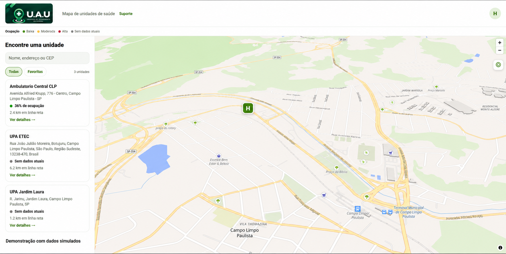
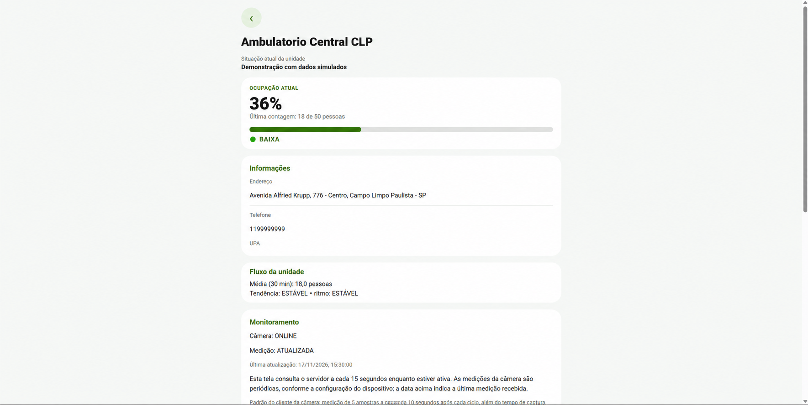

# UAU — Unidades de Atendimento de Urgência


## Descrição

O UAU é um sistema web e Android que facilita a consulta de unidades de saúde e o acompanhamento da ocupação estimada de áreas monitoradas por câmeras. Oferece mapa, busca por unidades, favoritos, avaliações, relatórios e suporte para ajudar o usuário a encontrar informações em um só lugar.

## Equipe

- Gabriel Becca dos Santos — Desenvolvedor do site e auxílio na parte escrita
- Matheus de Souza Andreato — Parte Escrita e Organização
- Kevyn Fernandes Freitas — Parte Escrita

As responsabilidades de planejamento, desenvolvimento, testes e documentação foram divididas igualmente entre os três integrantes.

## Tecnologias utilizadas

- HTML e CSS, gerados pelo React Native Web 0.21.2.
- TypeScript 6.0.3, React 19.2.3 e React Native 0.86.3.
- Expo SDK 57 e Node.js 22.13 ou superior compatível.
- Java 21 e Spring Boot 4.1.0.
- PostgreSQL 15 ou superior.
- Python 3, OpenCV 4.9 a 4.x e YOLOv8n ONNX.
- MapLibre GL 6.9.0 e Apache PDFBox 3.0.8.

## Imagens do sistema

### Página inicial



### Consulta de ocupação da unidade



As imagens foram editadas para demonstrar a câmera ativa com dados simulados de ocupação.

## Como executar o projeto

1. Instale Java 21, PostgreSQL 15 ou superior e Node.js 22.13 ou superior compatível.
2. Crie o banco PostgreSQL `uau`.
3. Configure no terminal do backend as variáveis `DB_URL`, `DB_USERNAME`, `DB_PASSWORD`, `JWT_SECRET`, `RECOVERY_SECRET` e `CORS_ORIGINS`, conforme o arquivo [.env.example](.env.example). O backend não carrega esse arquivo automaticamente. Use chaves aleatórias de pelo menos 32 caracteres e `CORS_ORIGINS=http://localhost:8081` para o acesso local.
4. Na raiz do projeto, inicie o backend:

   ```powershell
   .\mvnw.cmd spring-boot:run
   ```

5. Em outro terminal, entre em `mobile` e instale as dependências:

   ```powershell
   cd mobile
   npm.cmd ci
   ```

6. Crie `mobile/.env.local` com o endereço da API:

   ```env
   EXPO_PUBLIC_API_URL=http://localhost:8080
   ```

7. Compile e inicie o frontend:

   ```powershell
   npm.cmd run build:web
   node scripts/serve-web.mjs
   ```

8. Abra [http://localhost:8081](http://localhost:8081). Após alterar o frontend, repita a compilação antes de iniciar o servidor.
9. Para usar a câmera, siga a configuração em [camera/README.md](camera/README.md) e execute `python main.py` na pasta `camera`.

## Como citar o projeto

SANTOS, Gabriel Becca dos; ANDREATO, Matheus de Souza; FREITAS, Kevyn Fernandes. **UAU — Unidades de Atendimento de Urgência**. Software desenvolvido no projeto de TCC do grupo 10, 2026.
